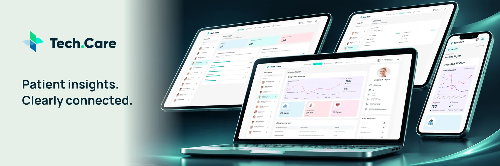

# Tech.Care

## Overview

Tech.Care is a responsive healthcare dashboard for browsing patient profiles, diagnosis history, vital signs, and diagnostic summaries. It combines an API-backed patient workspace with overview insights and additional schedule, messaging, transaction, doctor-profile, and settings views.

## Project Preview



## Key Features

- Search and select patients to update their profile, chart, vital signs, diagnoses, and lab-result list.
- Review the latest six valid blood-pressure records in chronological order, with an accessible data-table alternative.
- Explore overview totals, condition counts, and diagnostic-status breakdowns across available patient records.
- Use responsive navigation, a mobile patient drawer, independent scrolling, and auto-hiding scrollbars.
- Filter appointments by date and invoices by status, view supporting details, and switch between conversations.
- View doctor information and refresh patient records from Settings.
- Recover from failed requests with timeout handling, retry controls, and retained records during refresh failures.

## Live Website

[https://techcare-liart.vercel.app/](https://techcare-liart.vercel.app/)

## Technology

React 18, JavaScript/JSX, CSS, Vite 5, and Chart.js 4. Tests use Node.js's built-in test runner, Vite's SSR module loader, and React server rendering.

## Getting Started

Node.js 24.x and npm are recommended; the project was verified with Node.js 24.13.0 and npm 11.12.1.

From the repository root:

```bash
npm ci
```

Copy `.env.example` to `.env` and provide the patient API credentials:

```dotenv
VITE_COALITION_USER=your_api_username
VITE_COALITION_PASSWORD=your_api_password
```

The API provider's documentation link is included in `.env.example`. These `VITE_` values are included in the browser build and sent in a Basic Authorization header. Use credentials intended for this frontend integration; private credentials require a server-side service. Keep `.env` out of Git.

Start the development server:

```bash
npm run dev
```

Open the URL printed by Vite. The default development port is 5173; Vite may choose another port if it is occupied.

## Commands

| Command | Purpose |
| --- | --- |
| `npm run dev` | Start the development server. |
| `npm start` | Start the same Vite development server. |
| `npm run build` | Generate the production site in `dist/`. |
| `npm run preview` | Serve the production build locally after building. |
| `npm test` | Run the automated tests. |

## Data and Functional Scope

Patient records and overview calculations use the remote patient API. Appointments, initial conversations, transactions, and additional doctor information are defined locally. Replies are kept in memory for the current session and are not delivered to a messaging service.

Patient editing, archiving, message actions in the patient menu, and lab-download buttons are clickable interface controls without an associated operation. Settings displays fixed preferences and provides a working patient-data refresh action. The application includes no backend, database, user sign-in, payment processing, or persistent appointment management.
